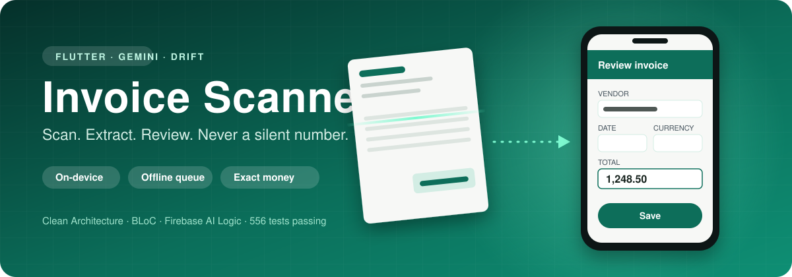
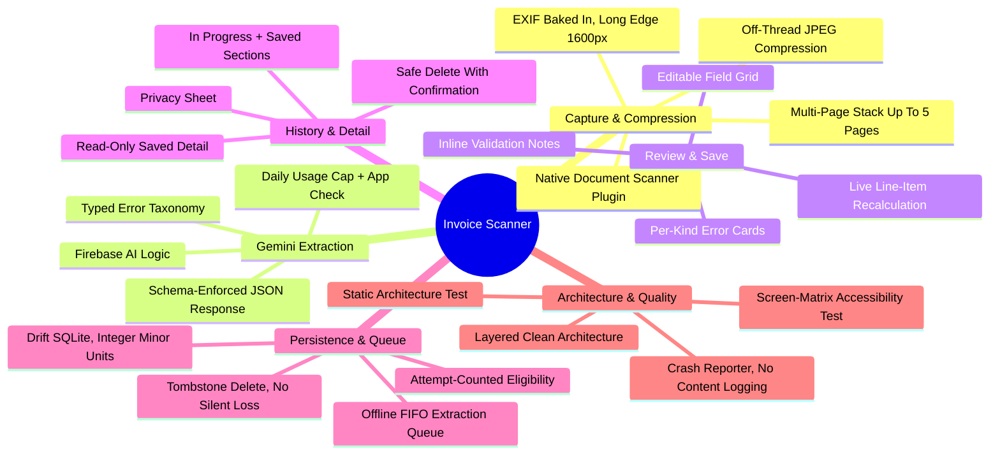
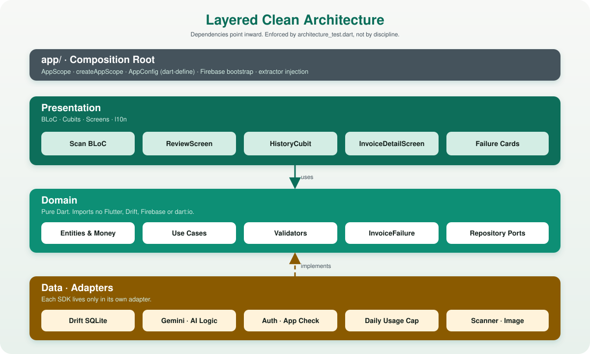
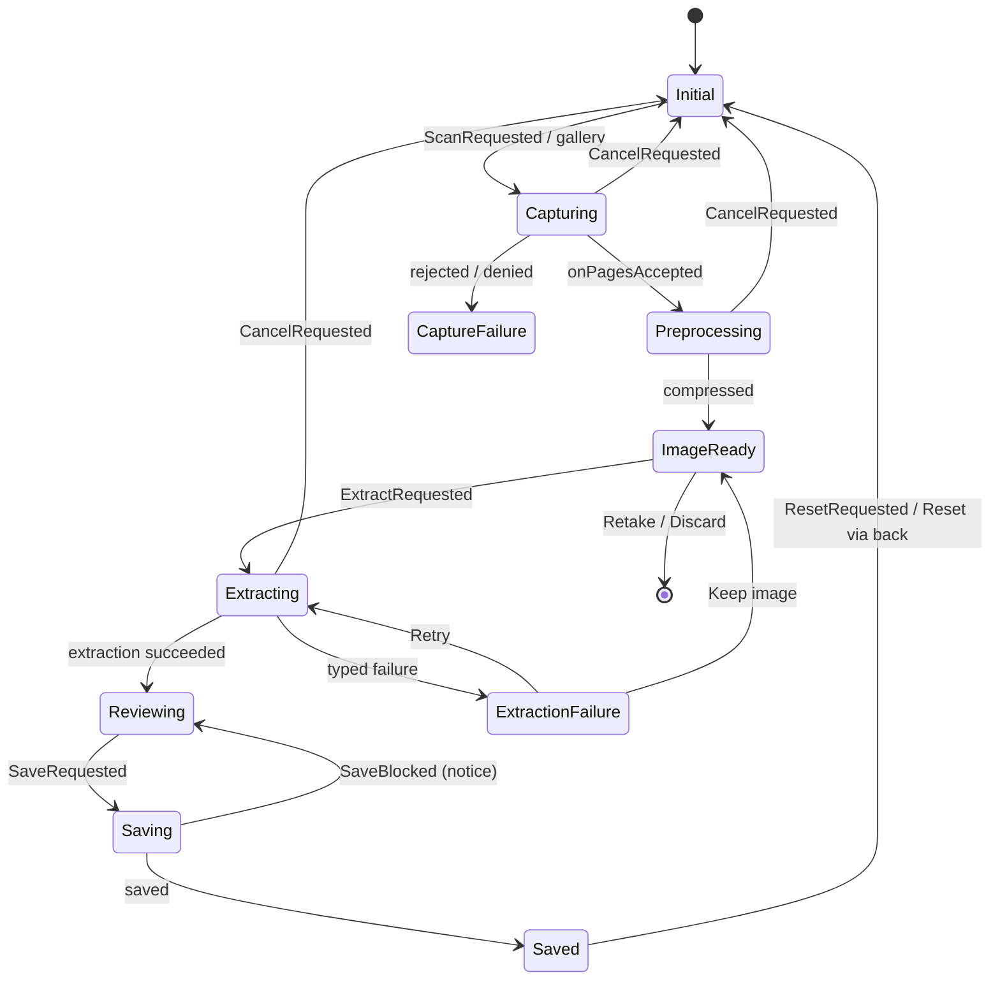

<div align="center">



<br />

# 📄 INVOICE SCANNER
### Production-Grade Invoice Capture, Gemini Extraction & On-Device Review
**Built with Flutter 3.38 · Dart 3 · BLoC · Drift SQLite · Firebase AI Logic · Clean Architecture**

<br />

[](https://flutter.dev/)
[](https://dart.dev/)
[](https://bloclibrary.dev/)
[](https://drift.simonbinder.eu/)
[](https://firebase.google.com/)
[](https://flutter.dev/docs/testing)
[](https://dart.dev/tools/analysis)
[](https://github.com/Abdulgeni/invoice_scanner-app/releases)

<br />

**Invoice Scanner** is a production-grade, Android-first Flutter application that turns paper invoices into clean, editable, on-device records. It captures pages through the native document scanner, compresses them off-thread, sends them to **Gemini Vision via Firebase AI Logic**, and presents every extracted field on a review screen that never silently changes a number. A typed BLoC flow, a Drift SQLite store, an offline FIFO extraction queue, and a strict layered architecture keep the app honest about money and resilient to network and crash conditions.

</div>

---

## 🌟 Executive Feature Matrix



| Domain | Capability | Architectural Implementation Highlights |
|---|---|---|
| 📷 **Capture & Compression** | Scan invoices with the device camera or import from gallery, compress off the UI thread. | `cunning_document_scanner` adapter, `IsolateImagePreprocessor` producing JPEG pages (long edge ≤ 1600 px, EXIF baked, ≤ 5 pages), persisted to a managed image directory, cleaned on save/discard and on launch. |
| 🧠 **Gemini Extraction** | Read a scanned invoice with Gemini Vision and get a typed `Invoice` back. | Firebase AI Logic (`firebase_ai`) with schema-enforced JSON response, `ModelNameResolver` with Remote Config override + session-scoped fallback, typed `InvoiceFailure` taxonomy (network, timeout, quota, App Check, safety, empty, malformed, not-invoice), `AuthGated` → `Capped` extractor composition with a local daily cap and App Check tokens. |
| 📝 **Review & Save** | Every extracted field is editable; warnings never block save, unparseable text does. | `ReviewScreen` with `FieldValidity` microtask-safe invalidation, per-field `FieldNotes` carrying one-tap fixes, live line-item recalculation via `editLine`/`recalcLineTotal` (manual totals never overwritten), currency-aware `AmountField` with a per-currency key so a currency change reseeds the field. Save is blocked only by unparseable text. |
| 🧾 **History & Detail** | See unfinished and saved invoices, resume in progress, open saved read-only. | `HistorySections` pure grouping into attention + saved, `HistoryCubit` from a single `watchLive()` Drift stream, `_HistoryTile` with plain-language status per `InvoiceStatus` and per failure kind, `InvoiceDetailScreen` read-only with safe delete + confirmation + tombstone. |
| 💾 **Persistence & Offline Queue** | Every mutation persists; extraction retries survive crashes and offline periods. | Drift SQLite with integer minor units and exact currency on every money value, `DriftInvoiceRepository` with `insertIfAbsent` / `mutate` / `watchSaved` / `watchLive`, `ProcessExtractionQueue` eligible only for failed(network) and interrupted `pendingExtraction` (attemptCount > 0), `ExtractionQueueRunner` kicked on app resume. |
| 🏛️ **Architecture & Quality** | Layer rules, SDK confinement, no-logging, and layout rules are enforced by tests. | Static `architecture_test.dart` over the source tree (domain imports nothing Flutter; Firebase, Drift, the scanner plugin each confined to their adapters; no `print` / `developer.log` outside a guarded `debugPrint` allowlist; no hardcoded UI text; no left-to-right assumptions). `screen_matrix_test.dart` renders every screen in 5 environments × 11 screens, plus tap-target and labeled-target guidelines. |
| 🛡️ **Crash Reporting** | Uncaught errors are recorded by type, never by message. | `CrashReporter` interface with a `NoopCrashReporter` default, `installErrorHandlers` routes `FlutterError.onError` and `PlatformDispatcher.onError` recording only `runtimeType` and stack trace; tests confirm invoice content never reaches the reporter. |

---

## 🏛️ Layered Architecture

<div align="center">

</div>

Feature-first, layered structure:

```text
invoice_scanner/
├── lib/
│   ├── app/                     # Composition root, config, Firebase bootstrap
│   │   ├── app_composition.dart # AppScope + createAppScope (extractor injection)
│   │   ├── app_config.dart      # Build-time settings (dart-define)
│   │   └── firebase_bootstrap.dart
│   ├── core/
│   │   ├── async/               # CancellationToken
│   │   ├── error/               # CrashReporter + installErrorHandlers
│   │   ├── l10n/                # LocalizedNumberParser
│   │   ├── theme/               # Tokens, colors, typography
│   │   └── util/                # Clock, IdGenerator
│   ├── features/invoice_scanner/
│   │   ├── domain/              # Entities, value objects, use cases, validators
│   │   ├── data/                # Drift DB, repositories, Gemini, auth, usage, image
│   │   └── presentation/        # BLoC, cubits, screens, widgets, l10n
│   └── main.dart
├── test/                        # ~600 tests across domain, data, presentation, architecture, accessibility
├── android/                     # Manifest, Gradle signing, adaptive icon
├── assets/icon/                 # SVG + PNG master
└── docs/                        # PRIVACY_AND_RETENTION, DEVICE_TEST_CHECKLIST, RELEASE_CHECKLIST
```

### Strict Engineering Invariants
1. **Layer isolation**: the domain layer imports no Flutter, Drift, Firebase, or `dart:io`. Enforced by `architecture_test.dart`, not by discipline.
2. **SDK confinement**: Firebase, Drift, and the scanner plugin each live only in their data-layer adapters.
3. **Money correctness**: every amount is stored as integer minor units with an explicit currency. Nullable fields stay null; nothing defaults silently.
4. **Extraction queue eligibility**: a scan is auto-retried only if the user asked to read it (failed(network) or interrupted `pendingExtraction` with `attemptCount > 0`). A merely-captured scan never leaves the device.
5. **No content in errors**: `InvoiceFailure.debugCode` and the crash reporter carry only type names and short codes, never vendor names or amounts.
6. **Test-enforced layout**: no hardcoded user-visible text, no `EdgeInsets.only` / `TextAlign.left` / `Positioned` in UI; every screen renders in 5 environments in `screen_matrix_test.dart`.
7. **Signed release build**: release APKs are signed with the upload key from `key.properties`; the debug fallback is gone, so a release build fails rather than shipping a debug-signed artifact.

---

## 🔄 BLoC State Machine



---

## 🧪 Verification & Automated Tests

`flutter analyze` is clean and the full suite is green:

| Suite | Files | Role | Status |
|---|---|---|---|
| `test/features/.../domain` | domain entities, value objects, use cases, validators, offline queue | Money, currency, ISO dates, extraction, queue eligibility | ✅ |
| `test/features/.../data` | repository, Drift, Gemini classifier, auth, daily usage, guard extractor | Persistence, typed failures, auth gate, cap, refunds | ✅ |
| `test/features/.../presentation` | BLoC, cubit, review, saved, history, detail, processing, failure, capture | Screen rendering, review edits, validation, pickers, save | ✅ |
| `test/core` | number parser, contrast, crash reporter | Locale parsing, WCAG AA, error handling | ✅ |
| `test/architecture` | static layer + SDK + text + directionality rules | Enforce invariants without a reviewer | ✅ |
| `test/accessibility` | every screen × 5 environments | Render, tap targets, labels, small screen at 2× text | ✅ (2 deferred) |
| `test/platform` | Android manifest + release readiness | Manifest rules, placeholder detector | ✅ (3 gated) |
| **Full suite** | — | — | **556 passing, 9 skipped, 0 failing** |

### Execute Test & Quality Commands
```bash
# Full test suite
flutter test test/features/invoice_scanner test/core test/app test/platform test/architecture test/accessibility

# Analyze with zero tolerance
flutter analyze

# Release-safety gate (fails until Firebase is configured)
RELEASE_CHECK=true flutter test test/platform

# Build a signed release APK
flutter build apk --release --dart-define=USE_DEMO_EXTRACTOR=true
```

---

## 🚀 Quickstart & Installation

### 1. Prerequisites
- **Flutter**: `3.38+` (Dart `3.10+`)
- **Android SDK & ADB**: installed and on `PATH` (`minSdk 24`, `targetSdk 36`)
- **JDK 17+** for the release signing tool (`keytool`)

### 2. Install Dependencies
```bash
flutter pub get
```

### 3. Run on a Connected Android Phone
With USB debugging enabled and the device authorized:
```bash
flutter run --dart-define=USE_DEMO_EXTRACTOR=true
```
The demo extractor returns sample data after ~1.8 s. No Firebase needed.

### 4. Run with Real Gemini Extraction
Requires a Firebase project, `flutterfire configure`, App Check, and AI Logic provisioning — see `docs/RELEASE_CHECKLIST.md`. Then:
```bash
flutter run
```

### 5. Build & Install a Signed Release APK
Requires `android/key.properties` and `android/app/upload-keystore.jks` (see *Signing* below):
```bash
flutter build apk --release --dart-define=USE_DEMO_EXTRACTOR=true
adb install -r build/app/outputs/flutter-apk/app-release.apk
```

---

## 🔐 Signing (Release Builds)

Release APKs are signed with a real upload key; the debug fallback is gone.

1. **Generate the keystore** (one time, non-interactive form works reliably under MinTTY):
   ```bash
   keytool -genkeypair -v \
     -keystore android/app/upload-keystore.jks \
     -storetype PKCS12 -keyalg RSA -keysize 2048 -validity 10000 \
     -alias upload -storepass "<your-password>" -keypass "<your-password>" \
     -dname "CN=Your Name, OU=Dev, O=InvoiceScanner, L=City, ST=State, C=ET"
   ```
2. **Write `android/key.properties`**:
   ```properties
   storePassword=<your-password>
   keyPassword=<your-password>
   keyAlias=upload
   storeFile=upload-keystore.jks
   ```
3. **Keep the keystore safe.** `android/.gitignore` already covers `*.jks` and `key.properties`; neither ever enters git. Losing the keystore means every future update needs a new `applicationId`.

Verify the built APK is signed with your key:
```bash
apksigner verify --print-certs build/app/outputs/flutter-apk/app-release.apk
# V2 Signer: certificate DN: CN=<your name>, ...
```

---

## 🎨 Design Philosophy: Calm, Teal, Correct

| Token | Hex | Name |
|---|---|---|
| Primary | `#0B6E5A` | Deep Teal |
| Primary Container | `#D3EDE4` | Soft Mint |
| Secondary | `#44525C` | Slate |
| Tertiary | `#8A5A00` | Amber |
| Error | `#B3261E` | Deep Red |
| Surface | `#F7F8F6` | Almost White |
| On-Surface | `#14201C` | Near Black |
| Semantic Success / Warning | container + on-container | defined per theme |

Light and dark themes both pass WCAG AA contrast in `test/core/theme/contrast_test.dart`. Typography uses tabular numerals for all money values so columns line up at any text scale. `AppMoneyStyles` provides `body`, `title`, and `display` variants that all read the same font features.

---

## 📚 Documentation

| Document | Purpose |
|---|---|
| [`docs/PRIVACY_AND_RETENTION.md`](./docs/PRIVACY_AND_RETENTION.md) | What is stored on the device, what leaves it, how deletion works, provider terms to verify. |
| [`docs/DEVICE_TEST_CHECKLIST.md`](./docs/DEVICE_TEST_CHECKLIST.md) | Capture, offline, failure, privacy, accessibility, performance, and accuracy-evaluation rows for a real device. |
| [`docs/RELEASE_CHECKLIST.md`](./docs/RELEASE_CHECKLIST.md) | Automated gates, Android, iOS, Firebase, legal, and known-limitations gates for shipping. |

---

## ✅ What's Delivered

- **13 modules**, all committed, all pushed.
- **`flutter analyze` — 0 issues**, full suite **556 passing, 9 skipped, 0 failing**.
- **Signed release APK (63.3 MB, V2 scheme)** built and installed on a physical Android phone; the full **scan → extract → review → save → history → detail** flow was exercised end-to-end.
- **Adaptive launcher icon** generated for every density plus monochrome layer.
- **Architecture, screen-matrix, crash-reporter, and platform tests** enforce the invariants without a reviewer.
- **Three release documents** matching what the code does.

---

## 🧭 Known Limitations

- **9 skipped tests** — 3 `RELEASE_CHECK`-gated (Firebase placeholder), 2 screen-matrix 320×2× overflows in `PreviewScreen` and `ReviewScreen` (`TODO(module-13)`), 4 deferred review/echo edge cases.
- **Firebase AI Logic not configured in the released APK.** The app degrades cleanly to the demo extractor or `UnavailableInvoiceExtractor`; real extraction requires `flutterfire configure` and the console setup from `docs/RELEASE_CHECKLIST.md`.
- **No Play Store listing yet.** The released APK is sideloadable from GitHub Releases; Play submission requires `applicationId` (already `io.github.abdulgeni.invoicescanner`), a signing key (already configured), a privacy policy URL, and the Play Console forms.
- **No iOS build.** Android-first, by design.

---

<div align="center">
  <sub>Engineered with precision for correct money, calm errors, and honest state.</sub>
  <br />
  <strong>Invoice Scanner © 2026 · Addis Ababa</strong>
</div>